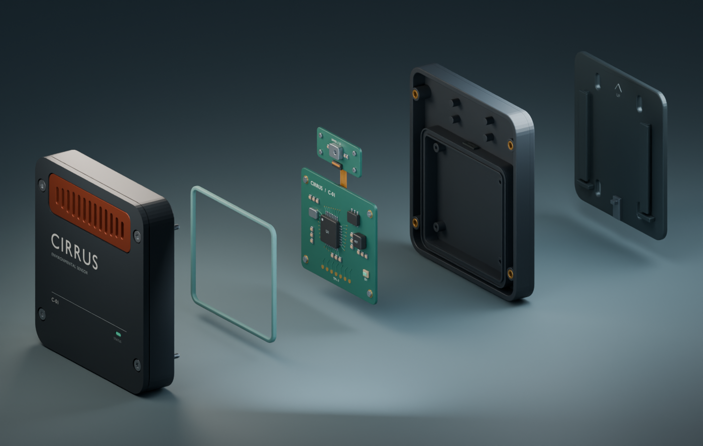
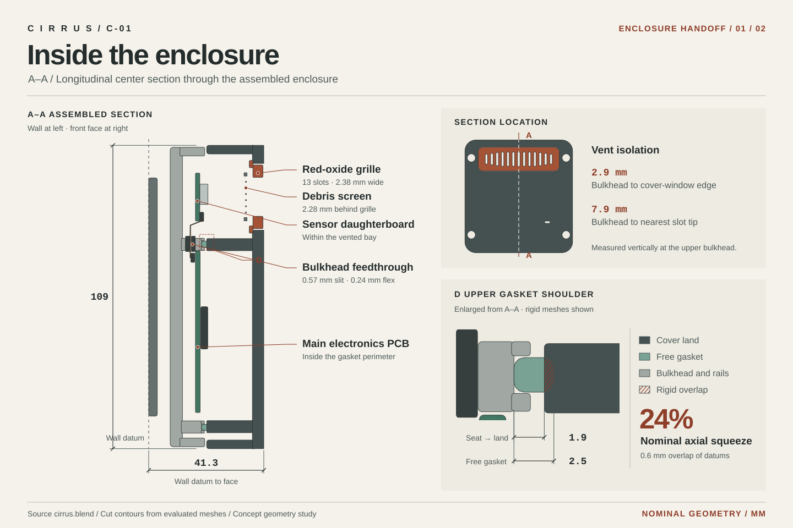
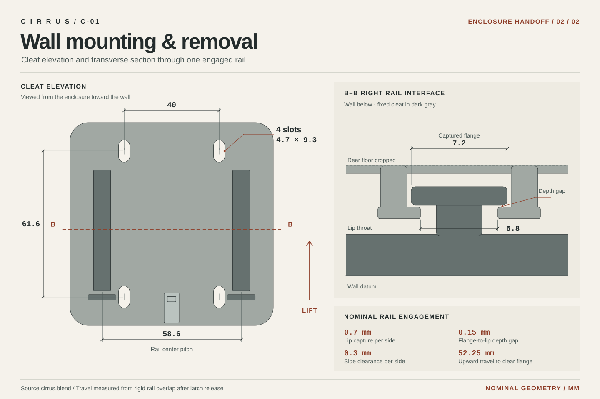

# Cirrus C-01

Cirrus C-01 is an independent industrial design study for a wall-mounted environmental sensor. The editable Blender assembly includes the enclosure, vent cassette, two boards, gasket, captive hardware, and wall cleat. The nominal body envelope is **104 × 109 × 33.6 mm**, with **41.3 mm** from the wall datum to the molded face.



[Assembled studio view](renders/hero.png) · [Product campaign](https://github.com/muhammmmadziam1234-eng/cirrus-formline-ad-campaigns#cirrus)

## Enclosure section

The oxide grille and debris screen sit over the sensor daughterboard. The raised bulkhead separates that bay from the main board, and the flex crosses it through a silicone feedthrough. Detail D shows where the cover land intersects the undeformed gasket in the assembled model.

[](renders/section.svg)

## Wall mounting and removal

Four slots locate the wall cleat. Two captured rails guide the enclosure vertically. The transverse section shows the flange, lip capture, and clearance. Removal travel is measured from the assembled position after assumed latch release.

[](renders/mounting.svg)

[Enclosure handoff and measurement datums](handoff/README.md) · [Machine-readable measurements](handoff/measurements.json)

The vent offsets describe spatial separation. The feedthrough has a modeled gap around the flex, and gasket squeeze is calculated from rigid geometry. Ingress, airflow, thermal and sensor performance, seal force, manufacturing tolerances, mounting loads, and practical service access require separate validation.

## Open and explore

Open `cirrus.blend` in Blender 4.5.4. The file opens assembled. Select **Cirrus | Explode control** in the Outliner, then set **Object Properties → Custom Properties → Explode** from 0 to 1 to spread the five assembly layers along the cover-removal axis. **Camera · 01 Hero** and **Camera · 02 Exploded** frame the two configurations.

## Reproduce and verify

From the project folder, use Blender 4.5.4 to verify the two drawing sheets, measurement file, and handoff table against the saved model. The command also checks that all 13 grille slots and four anchor slots pass through their respective parts.

```powershell
blender --background --threads 3 cirrus.blend --python-exit-code 1 --python build_handoff.py -- --check
```

Omit `-- --check` to regenerate the handoff files. The exporter reads the assembled model and leaves the Blender file untouched.

To rebuild the editable scene from its source, run the command below. The builder checks the closed part geometry, openings, fastener and board alignment, gasket stack, explode drivers, and camera framing before saving.

```powershell
blender --background --factory-startup --threads 3 --python-exit-code 1 --python build_cirrus.py -- --build-only
```

Omit `-- --build-only` to render the studio views, or use `-- --preview` for smaller proofs. The scripts use Blender's bundled Python and require no external assets.
